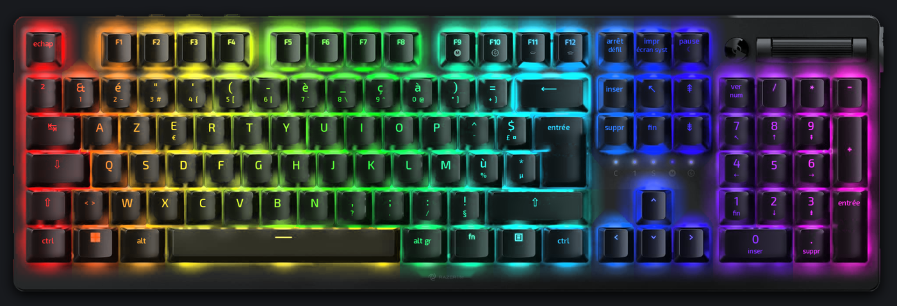
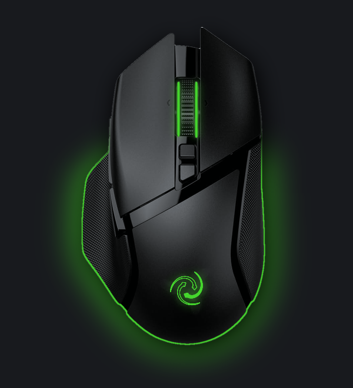
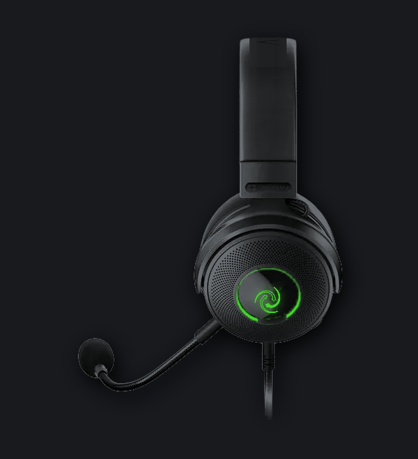

# RazerLite v0.5.22 : documentation

À jour au 23 octobre 2026. Mode d'emploi pas à pas : [GUIDE.md](../GUIDE.md).

## Présentation

RazerLite v0.5.22 remplace Razer Synapse sous Windows pour trois appareils : la souris Basilisk V3 Pro, le clavier DeathStalker V2 Pro et le casque Kraken V3 HyperSense. Il envoie directement aux appareils les mêmes commandes USB qu'OpenRazer sous Linux, sans pilote ni service en arrière-plan. C'est un projet indépendant, sans lien avec Razer.

- **Installation** : télécharger `RazerLite.exe` dans la [dernière version](../../../releases/latest). Il marche sans Python. La version Python (`RazerLite-pack.zip`, `install.bat`) reste disponible.
- **Synapse** : il doit être coupé, car les deux logiciels ne peuvent pas parler aux appareils en même temps. `synapse-off.bat` l'arrête proprement et `synapse-on.bat` le remet.
- **Mises à jour** : chaque modification publiée sur le dépôt produit une version `0.5.N`. L'appli vérifie au démarrage puis toutes les 6 heures. Un bandeau propose « Mettre à jour », qui télécharge, remplace et relance l'appli. Les profils sont gardés dans `%APPDATA%\RazerLite`.
- **Fonctionnement** : tout s'applique en direct et s'enregistre dans le profil actif, sans bouton « Appliquer ». Fermer la fenêtre la cache seulement dans la barre des tâches.
- **Diagnostic** : `diag.bat` produit `razerlite-diag.txt`, qui liste ce que Windows voit et la réponse de chaque appareil.

## Appareils pris en charge

Les trois appareils sont reconnus en câble comme en sans-fil (dongle HyperSpeed). Le Bluetooth n'est pas géré.

| Appareil | Identifiants USB | Onglets | Effets d'éclairage |
| --- | --- | --- | --- |
| Basilisk V3 Pro | 1532:00AA (câble), 1532:00AB (dongle) | Éclairage, Performance, Molette, Alimentation | Fixe, Spectre, Vague, Respiration, Par zone, Éteint |
| DeathStalker V2 Pro | 1532:0292 (câble), 1532:0290 (dongle) | Éclairage, Alimentation | Fixe, Spectre, Vague, Respiration, Réactif, Étoiles, Éteint |
| Kraken V3 HyperSense | 1532:0533 | Éclairage, Audio | Fixe, Vague, Respiration, Éteint |

Pour chaque appareil, la version du firmware s'affiche sous son nom. Le bouton « Firmware Razer ↗ » ouvre les outils officiels de mise à jour, et RazerLite ne flashe jamais un firmware lui-même.

## Souris Basilisk V3 Pro

La souris est l'appareil le plus complet : éclairage, DPI, fréquence, molette et veille.

| Onglet | Réglages |
| --- | --- |
| Éclairage | Effet, couleur (9 prêtes ou « + » pour une couleur perso), luminosité. « Par zone » donne une couleur à la molette, au logo et à la bande du dessous (11 LED). Sens pour la vague, durée pour la respiration. |
| Performance | DPI actuel en direct, 5 paliers réglables de 100 à 26 000 DPI par pas de 50 (curseur ou valeur exacte, interrupteur par palier, clic sur le numéro pour le rendre actif). Fréquence 125, 500 ou 1000 Hz. |
| Molette | Crantée ou libre, accélération, Smart Reel. |
| Alimentation | Niveau de batterie, état de charge, délai de mise en veille en minutes. |

- **Bouton DPI** : RazerLite remet la souris en mode matériel à l'ouverture, pour que le bouton DPI marche. À chaque appui, une notification affiche le nouveau DPI en bas de l'écran. Elle se coupe avec l'interrupteur « Notification DPI ».
- **Mémoire de la souris** : les paliers de DPI et l'éclairage sont aussi enregistrés dans la souris. L'effet « Par zone » ne l'est pas : il est renvoyé par RazerLite.
- **Appuis en direct** : quand la fenêtre est ouverte, les clics, la molette, les boutons latéraux et le bouton DPI s'allument sur l'aperçu.

## Clavier DeathStalker V2 Pro

Le clavier gère l'éclairage de tout le clavier et la batterie. Les couleurs différentes touche par touche ne sont pas encore envoyées au clavier.

| Onglet | Réglages |
| --- | --- |
| Éclairage | Fixe, Spectre, Vague (sens gauche ou droite), Respiration à 1 ou 2 couleurs, Réactif (les touches s'allument quand on tape), Étoiles, Éteint. Couleur et luminosité. |
| Alimentation | Niveau de batterie et état de charge (le délai de veille du clavier n'est pas encore réglable). |

- **Appuis en direct** : les touches tapées s'allument sur l'aperçu. Avec l'effet Réactif, l'aperçu réagit aux vraies frappes. RazerLite lit seulement quelles touches sont enfoncées à l'instant, n'enregistre rien et s'arrête quand la fenêtre est cachée.
- **Disposition** : l'aperçu est en AZERTY français ISO.
- **Macros** : elles passent par AutoHotkey v2 avec `macros\RazerLite-macros.ahk` (changer de profil, bureaux virtuels, raccourcis par jeu).

## Casque Kraken V3 HyperSense

Le casque a l'éclairage et un onglet Audio complet. Les égaliseurs et le nettoyage de la voix passent par Equalizer APO, gratuit.

| Réglage | Détail |
| --- | --- |
| Éclairage | Fixe, Vague, Respiration, Éteint, luminosité. |
| Casque | Volume, égaliseur 10 bandes avec préréglages Neutre, Jeu, Film, Musique, Basses+, Voix. |
| Micro | Sensibilité, sourdine, volume de la voix (jusqu'à +12 dB ajoutés en fin de chaîne). |
| Retour micro | Activé ou non, niveau 0 à 100 %. Mode « Casque » (fait par le casque) ou « RazerLite (faible délai) » (fait par le PC). |
| Nettoyage de la voix | Suppression de bruit RNNoise (clavier, souris, souffle, ventilateur), coupe-graves 90 Hz, anti-clics (coupe au-dessus de 8 kHz). |
| Égaliseur du micro | Neutre, Voix claire, Voix chaude, Radio, Voix forte, Perso. |

- **Réglage conseillé** : un bouton active suppression de bruit, coupe-graves, anti-clics, l'égaliseur « Voix forte » et +6 dB.
- **Retour micro, mode Casque** : le délai est inférieur à 1 ms, mais le firmware 1.07.04 l'a dégradé et le nettoyage du PC ne s'y applique pas, car le son reste dans le casque.
- **Retour micro, mode RazerLite** : le micro nettoyé est renvoyé dans le casque par un moteur WASAPI direct. Le pilote du Kraken impose des blocs de 10 ms, d'où environ 40 ms de délai, affiché dans l'onglet. Si ce moteur échoue, RazerLite passe sur un moteur de secours et affiche la raison.
- **Equalizer APO** : à l'installation, cocher seulement le micro du Kraken dans « Capture devices ». Cocher sa sortie coupe tout le son, à cause du THX Spatial Audio du pilote Razer. L'égaliseur du casque reste donc sans effet pour l'instant. RazerLite désactive le `Preamp: -6 dB` et l'`Include: example.txt` par défaut d'APO et écrit ses réglages dans `config\razerlite.txt`.
- **Pas géré** : le réglage des vibrations HyperSense et le THX Spatial Audio (logiciel payant). L'équivalent gratuit est Windows Sonic pour casque.

## Aperçus visuels

Les trois aperçus reprennent les images officielles des produits, trait pour trait, avec le logo RazerLite à la place de celui de Razer. Ils s'allument avec les couleurs choisies et s'animent avec l'effet en cours.

- **Clavier** : image officielle convertie en AZERTY français ISO. L'entrée est en L, les touches « < > » et « * µ » sont ajoutées, le Maj gauche est raccourci et toutes les légendes sont en français. Chaque touche et son halo prennent leur propre couleur, et les touches tapées s'allument.

  
  

- **Souris** : image officielle. Molette, logo et bande du dessous s'allument séparément, le symbole RazerLite remplace le serpent. Les clics, la molette et les boutons s'allument quand on les utilise.
- **Casque** : image officielle de profil. L'anneau lumineux garde sa vraie lumière et le symbole RazerLite remplace le serpent.
- **Logo RazerLite** : trois serpents redessinés, avec « RAZER » en Michroma et « lite » en Exo 2, deux polices libres.
- **Droits** : les images officielles appartiennent à Razer. Des dessins faits à la main servent de secours si une image manque.

## Profils, options et limites

**Profils et options générales**

- **Profils** : « Nouveau » copie le profil actuel, « Supprimer » retire celui affiché. Un profil « Nuit » est prêt. Le profil réapplique tous les réglages des trois appareils.
- **Démarrer avec Windows** : RazerLite se lance dans la barre des tâches et applique le profil.
- **Icône de la barre des tâches** : clic droit pour changer de profil, chercher une mise à jour ou quitter. Une alerte apparaît sous 15 % de batterie.
- **Ligne de commande** : `py -m razerlite list`, `effect`, `dpi`, `poll`, `apply <profil>`, `battery`.
- **Suivi d'OpenRazer** : chaque lundi, GitHub ouvre une fiche dans les Issues du dépôt si OpenRazer change quelque chose pour ces trois appareils.

**Pas encore géré**

- Couleurs touche par touche envoyées au clavier (l'aperçu les montre déjà).
- Vibrations HyperSense du casque, Bluetooth, égaliseur de sortie du casque (conflit THX).
- Ancien firmware 1012 du Kraken, au retour micro sans délai : une demande est en cours auprès du support Razer.

**Pistes pour plus tard**

- Retour micro RazerLite : réduire la marge de sécurité (environ 10 à 15 ms de moins, risque de craquements) ou passer en mode exclusif.
- Ouvrir RazerLite à toute la gamme Razer, avec les onglets de Synapse pour chaque appareil.
